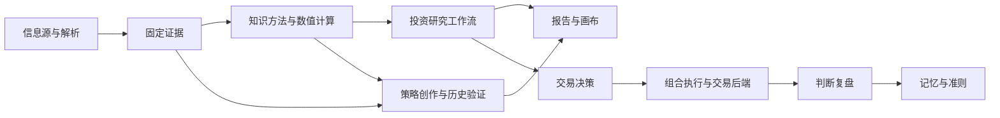

# Sesame 插件功能分类、文件架构与实现建议

状态：首批实现已验收；本文的九类分类决策已由 [2026-10-19 任务职责分类](2026-10-19-plugin-responsibility-taxonomy.md)替代，当前五类和全量归属见[架构说明](../plugin-functional-architecture.md)。其余脚手架与 ICT／MT5／Investment Research 首批迁移见[实施验收](2026-10-19-plugin-architecture-implementation.md)。下文保留当时的核查与方案记录。
核查日期：2026-10-18
范围：当前本地工作树的 Plugin API 2 源码。统计包含未提交开发内容，不表示已发布、已安装或已经通过业务验收。

## 1. 结论与目标

建议采用两个独立维度：

- **业务功能分类**：回答“这个插件解决什么问题”，用于插件库、文档与能力发现。
- **实现类型**：回答“这个插件怎么实现”，用于脚手架、包内目录和测试选择。

保留现有 core / optional 的发行目录和稳定插件 ID，通过现有 inventory policy 维护功能分类；包内按实际职责拆文件。这样能逐包整理，继续支持独立安装、更新与现有校验，不需要新框架或依赖。

设计目标是减少职责重叠、让能力可组合、保留证据与恢复行为，同时控制提示词长度、运行开销和迁移范围。当前不需要新增统一插件基类、跨包 shared 目录或另一套工作流引擎。

## 2. 当前事实

实际读取两个源码根下的 plugin.json，共 **56 包：9 个核心包、47 个可选包**。目录名称仍含 api-v1，但插件实际声明 apiVersion: "2"。

当前 inventory-policy.json 只有以下五类：

| 当前 category | 数量 |
| --- | ---: |
| workspace | 6 |
| data | 6 |
| backend | 6 |
| strategy | 6 |
| research | 32 |

这些标签适合现有目录展示，但 research 混合了知识、计算、工作流和报告，backend 混合了行情、回测和交易接入，不能直接决定代码结构。

需要特别保留的事实：

- financial-research 提供 SEC/FMP/FRED/Reddit/CFTC 等信息源能力，应按“信息获取”理解。
- factor-research、strategy-research 以及八个分析方法包是知识贡献，当前没有注册执行 capability。
- quantskills-catalog 有可调用的目录检索能力；它属于知识导航业务，但不是纯知识实现。
- backtrader、vnpy 提供原生回测能力；当前实现不提供实盘交易。
- manual-trading 已不在当前开发包集合；研究、交易决策、账户执行分别由 investment-research、trading-decision、portfolio-execution 承担。
- 文档中的某次发布“9 + 45”与本地开发集合不同；本次没有据此推断线上数量。
- inventory.json 是描述清单。只读运行 inventory 校验失败，当前差异是 investment-research 缺少 investment_research_ask 的 tools / capabilities 元数据；本次没有修复该生成文件。

证据：[核心清单](E:/brief2great/sesame/sesame/plugins/api-v1/bundle-profile.json:7)、[可选清单](E:/brief2great/sesame/sesame/plugins/optional-api-v1/bundle-profile.json:7)、[分类政策](E:/brief2great/sesame/sesame/plugins/api-v1/inventory-policy.json:1)、[生成器](E:/brief2great/sesame/sesame/plugins/api-v1/scripts/inventory.mjs:7)。

## 3. 推荐九类业务功能

以下为建议分类；每个插件按主要职责只计一次。插件可以另有多个能力标签，例如 MT5 同时提供行情与执行。所有 ID 省略 sesame/ 前缀。

| 功能组 | 数量 | 插件 |
| --- | ---: | --- |
| 平台基础 | 5 | configuration、memory、orchestration、plugin-manager、workspace |
| 信息获取与解析 | 8 | data-access、web-sources、financial-research、akshare、ccxt、web-extract、rss-collect、market-data-parser |
| 方法与研究知识 | 11 | ict、price-action、elliott-wave、wyckoff、dow-theory、behavioral-finance、institutional-analysis、narrative-analysis、factor-research、strategy-research、quantskills-catalog |
| 量化计算与评估 | 19 | factor-evaluator，以及下表的 18 个 ABU 插件 |
| 策略创作与回测 | 4 | strategy-authoring、backtrader、vnpy、kurumi-replay |
| 研究与决策工作流 | 3 | investment-research、auto-factor-mining、trading-decision |
| 交易接入与执行 | 3 | mt5、qmt、portfolio-execution |
| 展示与交付 | 2 | reports、canvas-control |
| 判断复盘 | 1 | judgment-evolution |

ABU 计算包的进一步分组只用于导航，不建议因此合并包：

| 方法方向 | 插件 |
| --- | --- |
| 指标、趋势、价格与波动 | abu-indicators、abu-trend、abu-price-structure、abu-volatility |
| 比较与筛选 | abu-similarity、abu-stock-screening |
| 交易规则研究 | abu-breakout、abu-moving-average、abu-trend-pullback、abu-seasonality、abu-exit-rules、abu-position-sizing |
| 实验与评估 | abu-trade-metrics、abu-parameter-search、abu-ml-features、abu-trade-judges、abu-model-lab、abu-backtest-lab |

功能关系：



这是可组合关系，不是要求每次任务依次执行全部环节。简单问题可直接调用一个方法；已有匹配证据和结果应复用。

## 4. 仓库级目录：保留发行布局，增加功能索引

```text
plugins/
├── api-v1/                         # 当前核心 API 2 包；暂保留历史路径名
│   ├── packages/<plugin-slug>/     # 9 个核心包，保持平铺
│   ├── inventory-policy.json      # 已有分类、文案；建议扩展功能组/实现类型
│   ├── inventory.json             # 由脚本生成，不能作为安装授权
│   ├── bundle-profile.json        # 核心发行成员
│   ├── official-plugins.lock.json # 包文件与固定摘要
│   ├── scripts/
│   └── tests/                     # 核心 runner 当前只发现本层测试文件
└── optional-api-v1/
    ├── packages/<plugin-slug>/     # 47 个可选包，保持平铺
    ├── bundle-profile.json
    ├── official-plugins.lock.json
    ├── scripts/
    └── tests/
```

当前 buildLock 直接扫描 packages 的第一层目录，要求目录名为 slug，ID 为 sesame/<slug>。如果改成 packages/data/akshare，data 会被识别成待打包插件，现有流程无法直接使用。[打包约束](E:/brief2great/sesame/sesame/plugins/api-v1/scripts/plugin-lock.mjs:93)

建议在既有 policy 中扩展描述字段，例如以下**拟议字段，不是已有宿主协议**：

```json
{
  "akshare": {
    "category": "backend",
    "functionalCategory": "information",
    "implementationKinds": ["adapter"],
    "tags": ["a-share", "market-data", "read-only"]
  }
}
```

先保留原 category 和已有双语文案。生成器可从同一份 policy 产生开发文档与功能视图，避免另建手写 plugin registry。拟议字段需要补枚举、覆盖和兼容测试；不授予工具或安装权限。

网站当前只接受原有五个 category，并从发布目录生成预览，不能直接把本地开发 inventory 当成线上目录。若公开新功能组，需要同步发布元数据生成与网站展示链路；不可把 Kurumi 等未在公开目录中的开发包顺带加入发布。[网站校验](E:/brief2great/sesame/sesame-site/site/assets/plugin-inventory.mjs:28)

## 5. 插件级共同骨架

```text
<plugin-slug>/
├── plugin.json           # 身份、版本、兼容范围、入口
├── package.json          # 模块类型与包版本
├── capabilities.json     # 能力、知识、资源贡献、状态和产物契约
├── index.js              # 原生实现的薄注册入口；纯声明按实际需要保留
├── README.md             # 用途、真实输入输出、依赖和例子
├── LICENSE
├── PROVENANCE.md
├── prompt.md             # 可选：简短专业说明，通过 knowledge 显式声明
├── src/                  # 可选：按本插件业务职责划分
├── skills/               # 可选：方法、选择条件与使用边界
├── references/           # 可选：按需读取的详细参考
└── examples/             # 可选：固定输入、预期结果和来源说明
```

只创建实际需要的文件。包内目录可调整；capabilities.json 与其显式引用负责公开行为，不能依靠文件名自动发现。

API 2 声明根需包含 configSchema 和八个数组：capabilities、sources、views、services、knowledge、hooks、stateCollections、artifactSchemas；无贡献时用空数组。公开参数、输出 Schema 和绑定以该文件为准，不额外维护平行 tools.json。

源码中的可调用实现通过薄入口注册，例如：

```js
import { capability } from '@sesame/plugin-sdk/capabilities';
import { analyze } from './src/analyze.js';

export function createCapabilities(host) {
  return [
    capability('analyze', (input, signal, execution) =>
      analyze(host, input, signal, execution)),
  ];
}
```

此例只说明注册形状，需要与 capabilities.json 的 id、binding、输入输出一一对应。发布前同时核对所有新增文件、版本和摘要。

## 6. 五种实现模板

### A. 知识方法型

适用于 ict、narrative-analysis、factor-research、strategy-research 等。

```text
skills/<method>/SKILL.md
skills/<method>/references/method.md
skills/<method>/references/validation.md
examples/input.json
examples/expected.md
scripts/observe.py                 # 仅在确有可执行辅助脚本时添加
```

- knowledge 显式声明 prompt / skill / reference；没有执行能力就保持 capabilities: []。
- SKILL 说明解决的问题、所需证据、判据、反证和适用边界，不把每种方法写成完整取数—报告流水线。
- 可选辅助脚本必须记录真实执行与结果；加载了知识文件不等于执行了算法。
- 验证知识在宿主及成员 Agent 中可达，使用固定反例验证解释边界。

### B. 确定性函数与计算型

适用于 ABU、factor-evaluator、网页/RSS/行情解析器；同一模板横跨多个业务组。

```text
src/analyze.js                     # 或 parse.js：业务计算
src/input.js                       # 只有复杂领域前提需要单独校验时才拆
src/artifacts.js                   # 固定输入/结果和引用的交接
examples/input.json
examples/expected.json
```

- 快速计算采用 function + immediate；耗时评估可采用 function + run，不因运行时间长就改称 workflow。
- 运算由代码承担，prompt 解释选择条件与局限。复用已有参数/schema 验证，不重复建立一层验证框架。
- 固定来源、版本、可得时间、单位与参数，返回可重复结果及实际证据引用。
- 覆盖已知输出、空数据、缺失字段、时间边界和取消；因子评估另覆盖未来信息泄漏和样本切分。

### C. 数据源、引擎与平台适配型

适用于 akshare、ccxt、financial-research、mt5、qmt、backtrader、vnpy；纯解析器通常用模板 B。

```text
src/market.js                     # 有行情时
src/account.js                    # 有账户读取时
src/trading.js                    # 有实际执行时
src/source.js                     # 宿主 source 契约映射
src/environment.js                # 环境检查/准备能力，按需
src/worker.js                     # 专业进程调用，按需
python/bridge.py                  # 已有 Python SDK 需要时
```

- 以实际功能选择文件；不为 AKShare 添加空 account/trading 层。
- JS 负责公开能力、配置、宿主端口和生命周期；Python 负责现有专业库调用或数值工作。
- 优先沿用包已有运行方式。native 经声明 JS 能力调用受管理进程；MCP 包使用明确的 mcp.json。Python 文件不能直接作为原生 JS entry。
- 行情 source、账户 source 与交易 capability 分别声明；读取权限不隐式授予下单。
- 对连接错误、来源缺失、超时、断流和取消返回真实状态，保留账户/品种/时区/单位身份。
- 测试区分固定夹具、实际环境连接与真实业务调用；环境检测成功不等于回测或交易成功。

### D. Agent 与工作流型

适用于 investment-research、auto-factor-mining、trading-decision。

```text
src/runtime.js                    # 业务流程与宿主 Run 接续
src/members.js                    # 成员定义、模型与最小 allowedCalls
src/composition.js                # 已选能力与知识组合
src/artifacts.js                  # 固定中间成果与最终交接
src/checkpoints.js                # 状态复杂时再单独拆
src/report.js                     # 确有独立报告装配逻辑时再拆
```

- 单 Agent 用 agent 声明；多步骤编排用 workflow + run。固定静态流程可用已有 graph binding；动态成员与业务分支沿用 native workflow。
- 使用宿主的 Run、checkpoint、interrupt/resume、operationId；包中仅保存业务状态，不再实现通用 runs/list/wait/cancel。
- allowedCalls 决定工具权限；plugins 补充纯知识方法。知识装载不能替代工具授权。
- 研究生成固定成果；交易决策消费该成果和风险规则；portfolio-execution 接收明确目标并核对真实回执。
- HTML 报告是成果的一种展示。研究成果应保留机器可消费引用；仅重制报告时读取固定成果。
- 验证缺依赖暂停、恢复保持原 Run、已完成动作复用、知识到达成员、报告关联正确。

### E. 宿主服务、状态与呈现型

适用于 memory、judgment-evolution、reports、canvas-control、configuration 等。workspace/plugin-manager 沿用各自现有专用端口，可复用这一模板的薄注册原则。

```text
src/<business-feature>.js         # 例如 record.js、review.js、render.js
src/state.js                      # 有持久领域状态时添加
src/service.js                    # 确有宿主 service 贡献时添加
templates/                       # 仅报告模板等需要时
assets/                          # 仅实际需要的静态资源
```

- 用既有 host 端口和声明的 sources/views/services/hooks 接入，按需声明状态与产物 Schema。
- 记忆记录保留来源和适用条件；判断复盘保留事前判断、后续证据及修订记录。
- 报告读取固定成果；渲染器不承担后台行情抓取、研究决策或交易。
- 持久化数据使用宿主状态接口或该包已有私有存储，保持现有隔离和恢复约定。
- 测试状态权限、版本冲突、重启读取和显示产物的来源关联。

## 7. 跨包组合与错误处理

跨插件运行时调用使用公开契约：

```js
const accepted = await host.capabilities.invoke(
  'sesame/abu-trend#abu_trend_analyze',
  input,
  { signal, operationId }
);
```

调用方按结果契约处理即时结果或 Run 引用；目标必须声明 host 消费者，operationId 应来自当前业务操作的稳定身份。

不要从另一个插件目录相对 import 实现文件。官方打包器要求相对依赖位于本包文件集合内；通用运行能力优先复用既有公开 SDK。只有出现已经验证的公共需求时，才另行评估 SDK 扩展；当前分类工作不需要新增依赖。

错误至少区分：参数/证据不满足、外部依赖不可用、已取消或中断、执行结果未知。后者不能当作失败重新发单，应读取原 operationId 的真实回执并核对。checkpoint 与去重也不能宣称外部操作天然 exactly-once。

提示词只负责专业目标与使用说明；权限、数值校验、幂等和恢复必须由声明及代码执行。插件不再复制宿主身份与用户沟通规则。

## 8. 决策记录

| 决策 | 状态 | 选择与代价 | 备选 |
| --- | --- | --- | --- |
| ADR-01：分类与发行路径分离 | Accepted | 保留两个发行根，功能组放入 policy；改动小，但路径名称仍有历史痕迹 | 直接移动到 packages/<category>/<slug>：需同时修改打包器、装载、目录、站点链接与测试，当前收益不足 |
| ADR-02：五种按需模板 | Accepted | 同一功能组可有不同实现，降低空壳文件和重复框架 | 所有包统一 controller/service/repository：对纯知识和简单函数增加负担 |
| ADR-03：声明与公开能力组合 | Accepted | 通过 capabilities.json 和 host.capabilities.invoke 连接，包可独立更新；需要维护输入输出契约 | 跨包 shared import：不符合当前官方包验证与独立分发边界 |
| ADR-04：沿用宿主运行体系 | Accepted | 复用 Run、恢复和权限，插件只维护业务流程；业务检查点仍需作者设计 | 每包自建调度与 Agent 引擎：重复生命周期与恢复逻辑 |

另一种长期方案是统一 packages 根、以发行清单选择 core/optional。当前没有足够需求支持该整体迁移，建议保留为独立议题。

## 9. 实施顺序与验收

1. **统一描述清单。** 先核对 investment-research 声明与 inventory 的现有差异；按源码重新生成并检查。为已有 policy 增加建议分类字段，校验所有 56 个开发包恰好有一个主功能组、没有重复或漏项，现有 category 保持兼容。
2. **扩展现有脚手架。** 当前 scaffold 仅支持 native / skill。先完善这两种模板文档；adapter、workflow、service 模板按真实复用需求补到现有 scaffold，不新建第二套生成器。
3. **做三个代表性试点。** 按用户最终选择使用 ict、mt5、investment-research，先运行相关现有回归；覆盖不足时补能锁定行为的测试，再逐包整理。保持 ID 和能力契约稳定，包内入口和知识路径同步更新。
4. **扩展到接入和状态包。** AKShare/MT5/QMT、执行账本和私有状态具有不同生命周期，分别依据对应契约与回归整理；不与交易行为变更混在同一批。
5. **更新生成物与发布链路。** 源码、版本、lock、inventory、网站功能视图分别核对。迁移产生新字节时走现有版本和发布流程；不覆盖历史发布摘要。

最小验收按改变范围选择：

| 改动 | 需要的验证 |
| --- | --- |
| 分类和文档 | 56 包覆盖、无重复、所有链接有效；生成 inventory 与旧 category 兼容 |
| 包内文件移动 | 显式入口/knowledge/worker/MCP 路径存在；声明与注册一致；原有行为测试 |
| 工作流整理 | 知识和权限传递、Run 接续、稳定操作 ID、成果交接、报告关联 |
| 后端整理 | 来源身份、超时/取消/断流、实际环境 smoke；记录未运行的原生验证 |
| 发布字节变化 | 版本一致、lock 校验、正确的 core/optional 成员和包文件摘要 |

注意测试发现规则：核心 scripts/test.mjs 当前只扫描根 tests 第一层；可选 runner 已递归扫描 tests 和 packages。不要把核心测试搬到嵌套目录后误以为仍被 npm test 执行。包内文件通常进入发布锁，因此新的跨包集成测试优先放源码根 tests，继续保留已有包内测试的明确运行方式。

plugin_test 的原生静态检查不等于实际功能验收。本次是架构分析与设计文档新增，没有执行上述迁移或全量业务测试。

## 10. 实施入口与核查依据

- [当前插件作者指南](E:/brief2great/sesame/sesame/plugins/api-v1/packages/plugin-manager/skills/develop-plugins/references/authoring.md:1)
- [API 2 能力声明](E:/brief2great/sesame/mt5agent/docs/plugin-api-v2/declarations.md:7)
- [宿主工作流与恢复](E:/brief2great/sesame/mt5agent/docs/plugin-api-v2/control-flow.md:205)
- [已有脚手架](E:/brief2great/sesame/sesame/plugins/api-v1/packages/plugin-manager/scaffold.js:14)
- [脚手架 CLI](E:/brief2great/sesame/sesame/plugins/api-v1/packages/plugin-manager/scripts/create-plugin.mjs:5)
- [独立包导入检查](E:/brief2great/sesame/sesame/plugins/api-v1/scripts/plugin-lock.mjs:133)
- [公开 SDK 边界](E:/brief2great/sesame/mt5agent/modules/plugins/sdk-loader.js:4)
- [当前研究/决策/执行职责](E:/brief2great/sesame/sesame/docs/plans/2026-10-18-workflow-boundaries.md:1)
- [当前 ABU 计算说明](E:/brief2great/sesame/sesame/plugins/optional-api-v1/ABU-BASELINES.md:12)
- [核心测试发现规则](E:/brief2great/sesame/sesame/plugins/api-v1/scripts/test.mjs:6)
- [可选测试发现规则](E:/brief2great/sesame/sesame/plugins/optional-api-v1/scripts/test.mjs:6)
